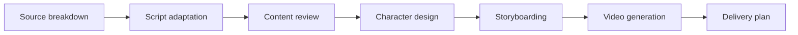

<div align="center">

# Frameflow · 映序

**A local workspace for turning stories into short-drama production assets.**

Coordinate specialist AI agents, review creative decisions, and keep every episode in one project.

[English](README.md) · [简体中文](README.zh-CN.md)

[](https://github.com/xutongxue233/short-drama-workspace/actions/workflows/ci.yml) [](package.json) [](docs/architecture.md) [](LICENSE)

[Quick start](#quick-start) · [Features](#features) · [Workflow](#workflow) · [Documentation](#documentation)


<sub>The screenshot uses fictional demonstration content. The application interface is currently in Simplified Chinese.</sub>

</div>

Frameflow brings source text, scripts, character designs, storyboards, generated media, and production decisions into a project chat. A producer coordinates specialist agents through a defined workflow; you approve or revise key outputs before production moves forward.

It runs on your computer with a React interface, a Node.js API, and SQLite storage. Generation uses the model services you configure and may incur provider charges.

## Features

- **A workspace for each story.** Keep source chapters, conversations, creative assets, generated media, and memory separated by project.
- **One episode at a time.** Import the next excerpt when you need it, reuse approved characters and settings, and preserve finished episodes as read-only archives.
- **Review before proceeding.** Approve the production brief, script, characters, storyboard, and delivery plan, or send feedback to the responsible agent.
- **Traceable creative work.** Inspect agent activity, handoffs, failures, approval history, and versioned assets. Redo a stage when its inputs change.
- **Project-based asset and media libraries.** Browse with pagination and search, preview generated files, and retry a failed download without generating again.
- **Bring your own model services.** Configure separate text, image, and video providers and bind them to editable agent roles.
- **Reusable creative skills.** Maintain instructions in the skill library, import/export `SKILL.md`, call a skill with `$skill-name` in chat, or bind skills to agents for their text tasks. Responses retain the skill versions used.
- **Multi-user collaboration.** Sign in with managed human or bot accounts, invite participants with project-scoped permissions, and keep optional job titles separate from access rights.
- **Local persistence.** Save projects and settings in SQLite; download generated media into the workspace data directory.

## Quick start

Install **Node.js 22.13+**, **npm 10+**, and Git. Node's built-in SQLite module may print an experimental warning on some supported versions.

```sh
git clone https://github.com/xutongxue233/short-drama-workspace.git
cd short-drama-workspace
npm ci
npm run workbench
```

Open **[http://127.0.0.1:5173](http://127.0.0.1:5173)**. The API listens on `127.0.0.1:3001`.

`workbench` keeps the API running without file watching, so editing server files does not interrupt an in-progress model request. The frontend still reloads during development. Keep the terminal open while using the app.

### Create your first episode

1. **Create the administrator account** on first launch, then use account management to create collaborator accounts. Existing projects belong to this first administrator.
2. **Connect providers** in **模型接入**. Add a service, enter its API key when required, choose a model, and enable it. Text stages need a text provider; character images and video need their respective providers.
3. **Assign agents** in **Agent 中心**. Bind each role to the appropriate service. Connection checks make read-only requests; they do not prove that every model is available to your account.
4. **Create a project** and import this episode's source text by pasting it or uploading a UTF-8 TXT or Markdown file. You do not need the whole novel or a fixed episode count.
5. **Start production** with **开始 / 继续制作**. Review the proposed scope, style, duration, and aspect ratio, then approve or request revisions as each stage finishes.
6. **Keep and reuse the results.** Review the project asset and media libraries. After all stages are accepted, archive the episode and import the next excerpt.

A fresh installation starts without sample projects or configured providers. The screenshot above is documentation-only example content.

### Run the built application

```sh
npm run build
npm start
```

Open **[http://127.0.0.1:3001](http://127.0.0.1:3001)** to use the frontend and API from one process.

### Optional configuration

Copy [`.env.example`](.env.example) to `.env` in the repository root when you need different defaults. Existing process environment variables take precedence.

| Variable             | Default | Purpose                                                                       |
| -------------------- | ------- | ----------------------------------------------------------------------------- |
| `API_PORT`           | `3001`  | Local API port; the development proxy follows this value                      |
| `WEB_PORT`           | `5173`  | Frontend development port                                                     |
| `WORKBENCH_DATA_DIR` | `data`  | Database and media directory; relative paths resolve from the repository root |

Configure model credentials in the app. Do not put them in frontend code or `VITE_` environment variables.

## Workflow



The producer coordinates the workflow and requests human approval at key stages. Confirmed character and storyboard references carry asset IDs and versions into later requests. Changing upstream work invalidates dependent stages so they can be produced again.

Project memory holds fixed facts, confirmed decisions, and summaries. Earlier episode archives retain their source text, outputs, and activity while shared project assets remain available for subsequent episodes.

## Model connections

| Protocol              | Supported use                                                          |
| --------------------- | ---------------------------------------------------------------------- |
| OpenAI-compatible     | Text chat and image generation/editing                                 |
| Anthropic native      | Text generation                                                        |
| Volcengine Ark native | Image generation and asynchronous video generation                     |
| MiniMax native        | Image generation and asynchronous video generation                     |
| Custom webhook        | Text, image, or video through the documented request/response contract |

Presets help fill in connection settings; model IDs and endpoints remain editable. Availability, permissions, reference-image limits, and output capabilities depend on the chosen provider and model. Protocol compatibility does not mean every service has been independently tested.

See the [model and webhook guide](docs/usage.zh-CN.md#配置真实模型) for request formats, reference handling, and connection-check behavior. Missing or invalid bindings produce an error; the app does not silently switch to another billing provider.

## Storage and privacy

By default, the workspace stores:

```text
data/
├── workbench.sqlite    # Projects, accounts, sessions, and encrypted provider credentials
├── workbench.sqlite.key # Encryption key; preserve with backups
└── media/              # Downloaded generated images, videos, and audio
```

- **Your workspace is local; generation requests leave it.** Relevant source text, prompts, project context, and reference media are sent to the model providers you configure.
- **Saved provider API keys are encrypted with AES-256-GCM.** The separate `workbench.sqlite.key` file is required to recover them. Passwords are hashed; session tokens and provider keys are omitted from public state and exports. Project text and media are not encrypted. Pre-upgrade databases, migration snapshots, and backups can still contain earlier plaintext keys; rotate those keys when upgrading and protect all backups.
- **Back up the entire data directory while the app is stopped.** Project JSON exports contain media references, not the media files themselves. Unsaved temporary provider links can expire.
- **Database upgrades preserve a migration snapshot.** Schema changes run in a transaction and roll back on failure. Back up before upgrading; migration snapshots are not an automatic downgrade mechanism.

The API binds to the loopback address by default. Every project API, export, and media download requires authentication and project membership. Project owners manage participants; editors can run production; members can chat; viewers can read. Account administration and model configuration are separate administrator privileges. See [security and deployment](SECURITY.md) before enabling access from other computers.

## Current limitations

- **Chinese UI.** The README is available in English and Simplified Chinese; the application itself is currently in Simplified Chinese.
- **Production assistance, not finished-episode rendering.** The default video stage generates the first approved shot that is not marked for post-production. The delivery stage prepares a production checklist and editing plan. Batch shot generation, voice-over, subtitle timelines, music, and final composition are not yet an end-to-end pipeline.
- **Provider-specific task recovery.** Resuming an existing video task is currently supported for MiniMax. Stopping local waiting does not necessarily cancel a remote provider task.
- **Bounded model context.** Long source material is excerpted; there is no vector retrieval or guarantee that the model has read an entire novel. Work in episode-sized excerpts and record essential facts in project memory.
- **Sequential episodes.** A project has one current episode. Archived episodes are read-only and cannot currently be reopened for editing.
- **In-memory runtime state.** SQLite writes changed entity records, and the UI uses project-scoped pagination, but startup still loads the workspace and saving compares all entities.

## Development

The frontend uses React, TypeScript, and Vite. The backend uses Express and Node's built-in SQLite module.

| Command             | Purpose                                                                    |
| ------------------- | -------------------------------------------------------------------------- |
| `npm run workbench` | Run the local workspace with a stable API process                          |
| `npm run dev`       | Watch both frontend and backend while developing                           |
| `npm run build`     | Type-check and build the frontend                                          |
| `npm start`         | Start the API and serve an existing frontend build                         |
| `npm test`          | Run backend and frontend tests                                             |
| `npm run format`    | Format source, configuration, and documentation                            |
| `npm run check`     | Run formatting, lint, architecture checks, tests, type-checking, and build |

Use `dev` for coding and isolated tests; a backend reload can interrupt an active generation. Do not run `dev` and `workbench` at the same time because they use the same ports.

Tests use isolated data and local provider fixtures; they do not require API keys or paid model calls. GitHub Actions is configured for Windows and Linux with Node.js 22 and 24.

## Documentation

Detailed technical documentation is currently in Simplified Chinese.

- [Usage and model configuration](docs/usage.zh-CN.md)
- [Architecture, storage, and API boundaries](docs/architecture.md)
- [Adding providers, agents, and workflow stages](docs/extending.md)
- [Frontend UI components](src/ui/README.md)
- [Contributing and verification](CONTRIBUTING.md)

For a bug report, include steps to reproduce, expected behavior, and relevant redacted logs in a [GitHub issue](https://github.com/xutongxue233/short-drama-workspace/issues). Keep API keys, private source material, databases, and personal media out of reports and pull requests. Report vulnerabilities privately using the [security policy](SECURITY.md).

## License

Frameflow is available under the [MIT License](LICENSE).
