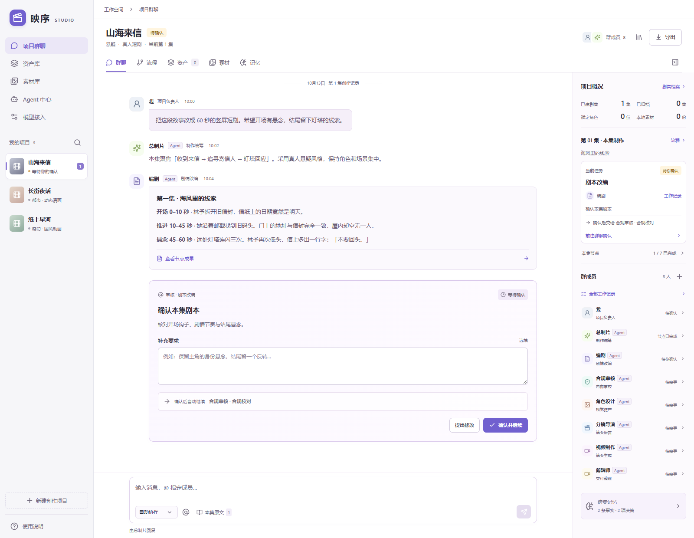

<div align="center">

# Frameflow · 映序

**把小说片段变成可审阅、可接续的短剧制作项目。**

以项目群聊串联原文、专业 Agent、人工审批和生成素材的本地创作工作台。

[English](./README.md) · **简体中文**

[](https://github.com/xutongxue233/short-drama-workspace/actions/workflows/ci.yml)
[](https://nodejs.org/)
[](./LICENSE)

[快速开始](#快速开始) · [创作第一集](#创作第一集) · [使用手册](./docs/usage.zh-CN.md) · [参与开发](./CONTRIBUTING.md)

</div>



_截图使用虚构项目和示例内容。当前应用界面为中文，README 提供英文与简体中文版本。_

## 为什么使用映序

短剧制作需要反复确认剧本、人物、分镜和生成结果。映序把这些决定保存在同一个项目中，让创作者看清当前进度、审阅每一步产物，并在返修或下一集制作时沿用已确认的标准。

| 能力                 | 工作方式                                                            |
| -------------------- | ------------------------------------------------------------------- |
| **围绕项目协作**     | 每个项目独立管理群聊、原文、制作流程、审批和记忆。                  |
| **逐集推进**         | 导入本集片段，确认制作方案；本集验收后归档，再开始下一集。          |
| **七个专业 Agent**   | 总制片协调编剧、内容审核、角色设计、分镜导演、视频制作和剪辑岗位。  |
| **创作者掌握决定权** | 审批关键产物、填写修改意见、锁定角色标准，从指定节点重新制作。      |
| **按项目管理素材**   | 分页查看资产和生成媒体，搜索、筛选、预览、下载；返修前的素材保留。  |
| **本机保存进度**     | SQLite 保存项目与配置，生成媒体下载到本机，支持失败重试与中断恢复。 |

## 快速开始

需要 **Node.js 22.13+**、**npm 10+** 和 Git。SQLite 使用 Node 内置模块，无需另外安装数据库服务；部分 Node 版本可能显示实验性提示。

```sh
git clone https://github.com/xutongxue233/short-drama-workspace.git
cd short-drama-workspace
npm ci
npm run workbench
```

打开 **[http://127.0.0.1:5173](http://127.0.0.1:5173)**。

此命令启动前端与 API，前端支持热更新，API 保持运行以避免文件修改中断真实生成任务。首次启动是空工作区，创作前需要配置自己的模型服务。

### 单进程运行

安装依赖后，构建页面并由 API 一并提供：

```sh
npm run build
npm start
```

打开 **[http://127.0.0.1:3001](http://127.0.0.1:3001)**。关闭终端会停止服务，再次启动可读取已保存项目。

### 可选配置

需要修改端口或数据位置时，将 [`.env.example`](./.env.example) 复制为 `.env`：

```dotenv
API_PORT=3001
WEB_PORT=5173
WORKBENCH_DATA_DIR=./data
```

相对数据路径从项目根目录解析。模型密钥在应用的「模型接入」中配置，不要写入前端代码或 `VITE_` 环境变量。

## 创作第一集

1. **接入模型。** 在「模型接入」添加并启用服务，在「Agent 中心」绑定所需的文字、图片和视频能力。连接检查不提交付费生成请求；实际生成由你的服务商计费。
2. **建立项目。** 填写项目名称、题材和初步风格，粘贴本集原文，或导入 UTF-8 TXT、Markdown 文件。无需先准备整本小说或确定总集数。
3. **启动制作。** 点击「开始 / 继续制作」，确认本集范围、风格、时长、画幅与发布平台。
4. **逐步审阅。** 在审批卡中批准或提出修改意见，核对角色样板、角色图和分镜；系统记录反馈并重做相应节点。
5. **整理成果。** 在项目资产中查看创作版本，在素材库中检查生成媒体和本地保存状态。当前集全部节点验收后，可归档并开始下一集。

```text
原著拆解 → 剧本改编 → 合规校对 → 角色定妆
                                   ↓
剪辑交付 ← 视频制作 ← 分镜设计
```

归档保留本集原文、产物和工作记录，下一集继续使用已锁定的项目角色与场景。归档表示流程验收，完整成片仍需要后续制作。

模型协议、角色确认、参考图传递与 Webhook 示例见[中文使用手册](./docs/usage.zh-CN.md)。

## 架构与数据

```text
浏览器工作台（React + TypeScript + Vite）
                    │
           本机 API（Node.js + Express）
                    │
       ┌────────────┼────────────┐
   SQLite 项目数据  本地媒体文件   已配置的模型服务
```

- **资产与素材有各自用途。** 资产保存剧本、角色标准、分镜等创作版本；素材记录每次生成的图片、视频等媒体，按项目展示。
- **数据库按项目与实体组织。** 项目、消息、资产、素材、原文、节点、剧集和配置分别存储，事务只写变化记录；实体详细字段仍使用 JSON。
- **日常读取按需分页。** 界面读取当前项目和导航摘要，聊天先加载本集最近 50 条，素材与资产按项目分页；剧集档案和完整工作记录按需读取。
- **旧数据自动迁移。** 迁移在事务中进行并保留原始快照，失败会回滚。升级前仍应备份数据目录。

默认数据位置：

```text
data/
├── workbench.sqlite    项目、配置与本地迁移快照
└── media/              已保存的生成媒体
```

**备份前停止工作台，然后复制整个数据目录。** 项目 JSON 导出不含模型密钥，也不内嵌媒体文件，不能替代完整备份。不要只复制正在写入的 SQLite 主文件。

数据库、模型密钥、原文、真实项目内容与备份均不应提交到 Git。`data/`、`.env` 和本地输出目录已被忽略；自定义数据或备份路径也需要保持在版本控制之外。

## 当前边界

映序目前面向本机单用户创作，以下范围有助于判断它是否适合你的工作方式：

- **界面语言：** 当前为中文，尚未提供完整的应用内多语言切换。
- **视频制作：** 默认生成已批准分镜中的首个非后期镜头。批量逐镜生产、配音、字幕时间轴、音乐和最终成片合成尚未完成；剪辑交付生成制作清单与计划。
- **长篇原文：** 可以保存章节，但模型上下文使用有限节选与近期对话，尚无向量检索或全书语义索引。建议逐集提供片段并维护固定事实。
- **云端请求：** 项目保存在本机；使用云端模型时，相关原文节选、提示词和选定的参考内容会发送给配置的服务商，生成过程需要相应网络连接。
- **凭据与访问：** API 密钥以明文保存在未加密的本机数据库中，状态接口和项目导出不返回密钥。服务绑定回环地址，尚无多人账户、远程访问鉴权或密钥保险库。
- **任务恢复：** 停止操作取消本地等待，远端任务可能继续运行。不同模型接口的恢复能力有差异，重试前应检查已有任务与素材记录。
- **存储规模：** 运行时仍将工作区整体加载到内存，保存时扫描实体后写入差异；尚未支持多实例并发写入。

## 开发

```sh
npm run dev               # 前后端热更新，供开发调试
npm run test:web          # 前端测试
npm run test:server       # 后端测试
npm run check             # 格式、Lint、架构、测试、类型检查与构建
```

`npm run dev` 会在后端文件变化时重启 API。持续运行真实生成任务请使用 `npm run workbench`，两者使用相同端口，不要同时启动。

测试使用隔离数据库与本地模拟服务，无需模型密钥，不调用付费模型。GitHub Actions 在 Windows / Linux、Node 22 / 24 组合下执行检查。

| 文档                                  | 内容                                   |
| ------------------------------------- | -------------------------------------- |
| [中文使用手册](./docs/usage.zh-CN.md) | 模型接入、制作流程、媒体保存与协议细节 |
| [开发指南](./CONTRIBUTING.md)         | 环境配置、代码约定、验证与数据兼容要求 |
| [架构说明](./docs/architecture.md)    | 模块边界、SQLite 存储和分页 API        |
| [扩展指南](./docs/extending.md)       | 扩展模型协议、制作节点和前端模块       |

发现问题或有改进建议，可提交 [Issue](https://github.com/xutongxue233/short-drama-workspace/issues)。请使用虚构的最小复现数据，并移除 API 密钥、私有原文和真实项目内容。安全漏洞请按[安全政策](./SECURITY.md)私下报告。

## 许可证

本项目采用 [MIT 许可证](./LICENSE)。
