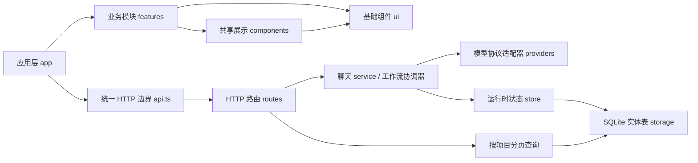

# 架构说明

这是一个单用户本地应用：React 工作台通过 `/api` 使用 Express，业务状态以 SQLite 事务保存检查点。工程保留单个 npm 项目，使开发、打包和部署入口一致。

## 前端边界

| 位置                             | 负责什么                                  |
| -------------------------------- | ----------------------------------------- |
| `src/main.tsx`                   | 应用挂载、全局样式、UI 预览入口           |
| `src/app/App.tsx`                | 当前项目、导航与弹窗组合                  |
| `src/app/useWorkspaceState.ts`   | 服务端快照、轮询、命令入口、全局通知      |
| `src/features/projects`          | 创建、原著导入、成员邀请、项目头部        |
| `src/features/workspace`         | 群聊、输入器、确认卡，以及项目标签页组合  |
| `src/features/workflow`          | 本集流程、项目概况、Agent 日志、剧集归档  |
| `src/features/assets` / `memory` | 资产筛选与编辑；事实、摘要与决策          |
| `src/features/agents` / `models` | Agent 配置；模型预设、配置与连接状态      |
| `src/components`                 | 跨业务展示组件，如头像和文本内容          |
| `src/shared`                     | 跨业务 UI 类型、状态名称                  |
| `src/ui`                         | 无业务依赖的基础控件、交互约定与设计变量  |
| `src/types.ts`                   | 浏览器使用的 API 数据类型                 |
| `src/api.ts`                     | 请求序列化、取消信号、HTTP 错误和响应解析 |

展示组件通过属性获得数据和动作，不自行复制整份工作区状态。表单、搜索、弹窗和输入器草稿留在各自组件；服务端快照由应用 hook 管理。旧快照不能覆盖新快照，卸载会取消待完成的轮询请求。

`useWorkspaceState` 轮询所选项目的精简快照，`projectSummaries` 供侧栏、项目切换和素材库选择器使用；摘要不等同于完整项目。切换项目或历史范围会取消旧请求，并通过修订号阻止过期响应覆盖当前状态。群聊以 `messagePage.startIndex` 将分页消息映射到项目原始消息序号，避免对本集消息再次应用整项目偏移；加载更早记录时保留已读位置。剧集档案与 Agent 日志打开后请求 `history=full`，完整响应到达前显示加载状态。

依赖从 `app` 指向 `features`，再指向 `components / shared / ui`。模块内部用直接相对导入，跨模块使用公开入口。`workspace` 可以组合其他项目功能；被组合的模块不能反向依赖它。基础 UI 不知道项目、模型、Agent 或 API。

`src/styles.css` 是工作台样式的有序入口，业务样式已拆到各模块，全局响应式规则位于 `src/styles/responsive`。Agent 与模型中心由模块入口加载样式；UI 设计变量和控件样式最后引入。拆分保留既有规则和级联次序。

## 后端边界

`index.mjs` 只启动监听器并处理关停。`app.mjs` 创建 Express 应用并注入配置、存储、工作流和聊天服务；导入模块不会自动监听端口或创建数据库。测试可注入隔离存储，并使用仅测试目录中的本地模型服务，不需要启动真实项目服务或调用付费模型。

`routes/` 解析 HTTP 输入、调用业务逻辑并返回响应；`http/` 统一处理输入校验、错误格式和本地访问限制。模型配置路由在 `routes/providers.mjs`，不是适配器的一部分。

## SQLite 存储与升级

`store.mjs` 持有可变的工作区对象，管理数据库独占权、连接和启动后的中断恢复。`storage/schema.mjs` 定义 schema v1，`codec.mjs` 在实体行与原有对象结构之间转换，`persistence.mjs` 负责迁移和事务保存，`queries.mjs` 负责 SQL 筛选、排序、分页和数量统计。数据库启用 WAL、外键和写入等待；项目子记录以 `project_id` 外键关联项目。

| 表                                                        | 内容                                             |
| --------------------------------------------------------- | ------------------------------------------------ |
| `workspace_metadata`                                      | 工作区额外字段与根集合存在标记                   |
| `projects`                                                | 项目基本信息、记忆、审批等字段与集合存在标记     |
| `agents`、`providers`                                     | Agent 与模型服务配置；密钥只保留在服务端         |
| `project_messages`、`project_assets`、`project_materials` | 消息、创作资产、媒体索引，按项目独立保存         |
| `project_chapters`、`project_nodes`                       | 当前集原文与制作节点                             |
| `project_episodes`                                        | 当前集边界元信息，以及包含历史产物的只读归档快照 |
| `schema_migrations`、`migration_backups`                  | 已应用的 schema 版本与迁移前原始快照             |

拆表粒度是实体，实体详情仍为 JSON `value`，没有把所有业务字段展开为列。实体行保存原 ID、数组位置和内部唯一键；编解码保留未知字段、重复实体 ID，以及缺省集合和空集合的区别。项目子表具备 `(project_id, position)` 与 `(project_id, id)` 索引，素材另有项目内创建时间与 ID 的排序索引。媒体二进制仍位于数据目录的 `media` 中，数据库只保存索引和引用。

首次打开 v0 数据库时，读取旧 `workspace` 单行 JSON，先保留原始字符串，再应用项目范围与剧集内容迁移。建表、备份、新实体数据、兼容视图和版本记录在一个 `BEGIN IMMEDIATE` 事务中提交，失败整体回滚。`migration_backups` 中的 `normalized-project-storage-v1` 保存存储迁移前的原始工作区；其他内容迁移也保留各自的首次快照，均不通过状态或导出接口暴露。

已有旧表改名为 `workspace_legacy_v0`，`workspace` 变为其只读 VIEW；全新数据库则创建空的同名只读 VIEW。视图用于阻止旧版应用写入，返回的旧内容不是当前状态，也不会随着新版保存更新。`PRAGMA user_version = 1` 与 `schema_migrations` 共同标记已完成升级，重复启动不会重做迁移；不支持的版本或不完整的迁移标记会拒绝打开。恢复或回退应使用停服后的完整数据目录备份，不应只修改版本标记或向旧表写入。

启动仍读取所有实体并还原完整内存对象。业务服务沿用同步修改后调用 `save()` 的契约；每次保存扫描并序列化所有实体，与上次成功提交的行比较，只对变化行执行 INSERT/UPDATE/DELETE，多个表的变化在同一事务中提交。失败不更新比较基线，后续重试可以重新保存。这减少 SQLite 写入量，但没有消除全量内存占用和实体比较成本；当前不是惰性项目存储，也不支持多个应用实例同时写入。

## 技能配置与调用

`server/skills.mjs` 定义技能输入校验、`SKILL.md` 解析/导出、有效绑定解析和调用快照。技能形如 `{ id, name, description, instructions, enabled, version, createdAt, updatedAt }`，Agent 使用可选 `skillIds`。工作区共享的 `skills` 配置保存在 v1 `workspace_metadata.value`，利用现有编解码器保留扩展字段的能力，无需改表或改 schema 版本。旧工作区缺省技能集合在 API 中映射为 `[]`，首次保存技能后持久化；Agent 的绑定随已有实体保存。

`routes/skills.mjs` 提供 `GET/POST /api/skills`、`PATCH/DELETE /api/skills/:id`、只解析不保存的 `POST /api/skills/parse`（`{ markdown }`），以及 `GET /api/skills/:id/export`（`{ filename, content }`）。修改、删除请求必须携带当前 `version`，不匹配返回 409，保存失败恢复内存状态。删除和清理绑定在同一次保存中完成。`PATCH /api/agents/:id` 可更新 `skillIds`，绑定允许停用技能，但不能指向不存在的技能。

聊天请求可附加 `skillIds` 或在内容中显式写 `$skill-name`。聊天服务先验证、合并、去重和复制技能，再记录消息及调用模型；显式技能消息进入讨论模式。Agent 的启用绑定用于文字工作流和角色文字规划；技能正文附加在任务 prompt 中，沿用现有系统指令与审批约束。单次合计最多 8 个技能，指令各最多 12000 字，避免超过模型适配层的系统提示词限制。实际调用记录在 `Message.event.skills` 保存 `{ id, name, version }`，新编辑不改变执行中的请求快照。

角色规划的检查点包含有效技能内容及版本，修改技能后重新规划，避免复用过时计划。媒体请求维持既有提示词和恢复标识。技能仅用于指令复用，不引入脚本执行、任意文件访问或工具调度。

## 项目快照与分页接口

只读接口集中在 `routes/queries.mjs`，`services/workspace-snapshot.mjs` 组合公开项目、运行时任务状态和导航摘要。生产存储的消息、素材、资产和数量查询直接使用 SQLite；仅测试注入的简化存储允许数组后备实现。`chatPending`、`backgroundTask` 与 `workflowIssues` 由运行时投影，模型服务沿用 `publicProvider` 脱敏，接口不返回 API Key。

| GET 接口                                                                     | 返回范围                                                                                                                                            |
| ---------------------------------------------------------------------------- | --------------------------------------------------------------------------------------------------------------------------------------------------- |
| `/api/state`                                                                 | 兼容旧客户端的完整工作区，包含所有项目、消息、素材和剧集归档                                                                                        |
| `/api/state?compact=1&projectId=<id>`                                        | `projects` 只含所选项目，`projectSummaries` 包含全部项目的导航元信息与计数；省略 `projectId` 时选择首个项目，明确传入不存在的 ID 时 `projects` 为空 |
| `/api/state?compact=1&projectId=<id>&history=full`                           | 所选项目恢复完整消息和剧集归档，供工作记录与档案弹窗读取；项目顶层 `materials` 仍为空数组                                                           |
| `/api/projects/:id`                                                          | 一个完整公开项目及计数、运行时任务状态                                                                                                              |
| `/api/projects/:id/messages?limit=50&before=<index>`                         | 本集消息，按原始序号向前分页                                                                                                                        |
| `/api/projects/:id/materials?limit=24&offset=0&type=all&status=all&q=<text>` | 一个项目内筛选后的素材页                                                                                                                            |
| `/api/projects/:id/assets?limit=24&offset=0&type=all&q=<text>`               | 一个项目内筛选后的资产页                                                                                                                            |

默认精简项目仍包含原文、节点、资产、记忆和当前集边界；`materials` 和 `episodeArchive` 为空数组，`messages` 只含本集最后 50 条。`snapshot.history` 区分 `recent` 与 `full`；`messagePage` 给出本集消息总量、首条返回消息的绝对 `startIndex` 和下一页的 `nextBefore`。空数组表示此快照未加载该集合，不表示项目没有历史或素材；应使用 `counts`。项目和摘要的 `counts` 包含 `assets`、`materials`、`savedMaterials`、`episodes`、`messages`，其中 `episodes` 包含当前集与归档集，`messages` 是整个项目的消息总数。摘要中的 `currentEpisode` 仅提供 ID、集号、标题与创建时间。

消息页返回 `{items, total, nextBefore, startIndex, episodeId}`，`items` 按消息原始序号升序排列。`before` 是不包含自身的整项目绝对序号，省略时取本集最新页；查询下界取运行时 `currentEpisode.startMessageIndex`，不会跨到上集。`total` 始终是本集消息数，`nextBefore` 无更早消息时为 `null`。使用上一页的 `nextBefore` 继续读取，新增尾部消息不会使游标偏移。

素材和资产均先按 `project_id` 限定，再筛选和分页，返回 `{items, total, offset, limit, hasMore}`。素材额外返回项目全部素材数 `projectTotal` 和本地保存数 `savedCount`，不受当前筛选影响；结果按 `createdAt` 降序、ID 降序排列，资产保持项目内数组顺序。素材 `type` 为 `all/image/video/audio`，`status` 为 `all/local/remote/failed/downloading`；资产 `type` 为 `all/character/scene/storyboard/script/video/audio`。`q` 最多 200 字符，去除首尾空白后做不区分大小写的字面子串查询：素材查名称、模型和提示词，资产查名称、说明和标签。素材可附带由节点信息补充的 `nodeName`。

分页 `limit` 为 1–100，消息默认 50、素材和资产默认 24；`before` 与 `offset` 必须是非负安全整数。无效枚举、重复参数、不支持的查询参数以及越界分页值返回 400；项目详情和分页接口找不到项目时返回 404。素材和资产使用 offset 分页，列表增删可能改变后续位置，客户端刷新时须处理页间重复和缺口；不能将其视为消息游标那样的追加稳定分页。

## 业务服务

`workflow.mjs` 保留顺序制作、审批、返修、暂停和失效控制；`workflow/memory.mjs` 负责上下文与摘要，`assets.mjs` 负责产物和版本，`templates.mjs` 维护节点任务及审批定义。

`workflow/character-checkpoint.mjs` 保存角色规划与逐张生成的未确认草稿，失败重试复用仍适用的成果，返修或创作条件变化后重新生成。给锁定的文字角色卡补图时保留原标准，图片经确认后才替换并归档旧版本，不能把文字卡当作已完成图片。

结构化图片规划使用 `pilot → batch` 两阶段检查点：首个需要新基础图的人物（无人物时选静物）先进入 `approval.phase = character-pilot`。采用样板只继续当前角色节点，不提前锁定或进入分镜；最终角色审批才锁定。样板确认校验本轮图片与创作依据未变化，记录决定后更新同一检查点摘要，保证断点恢复不重复付费。`visualStyleGuide` 参与摘要，单独修改仅使角色及后续节点失效。旧素材始终独立留档。

`workflow/character-planning.mjs` 构建独立的本集角色规划输入，只包含当前批准剧本、可用原文片段和有效锁定角色，不复用历史聊天或失败草稿。按本集出场需要逐步建档，群体拆成独立人物，未命名者保留称谓。规划未通过解析时最多反馈错误并自动纠正一次，通过后才请求生图；规划版本参与检查点键，避免复用旧规则下的清单。

`workflow/character-identity.mjs` 根据原文、当前已批准的改编剧本和有效锁定角色核对人物来源，将有依据的姓名与称谓归一到同一角色名称。角色资产不存在时正常创建未确认提案；只在批准剧本出现的人物标为改编新增。不能用模型自行提供的引文、历史草稿或其他类型的同名资产证明角色存在。已核实称谓随角色卡保存，视觉提示词据此识别剧本中的称呼；归一后重复角色会在图片请求前被拦截。

`workflow/visual-prompts.mjs` 单独构建角色与分镜图片指令。结构化基础图仅使用 `characterDesign.baseAppearance`、安全身份信息、必要年龄事实与项目 `visualStyleGuide`，`sceneStates` 留给镜头状态，避免剧情剪影、异常妆效污染基础图。实际图片参考仅传同名、已批准且有结构化基础设计的资产。分镜继续读取已批准剧本与锁定参考。各块有独立长度预算；提示词版本参与角色检查点摘要，更新生成策略后不复用旧策略下的未确认图片。

`services/materials.mjs` 独立维护项目 `materials` 素材索引与数据目录 `media` 中的原文件。每次新生成创建新记录，同一生成结果恢复时通过稳定 `captureId` 复用记录；资产通过 `materialId` 引用其中一份。资产返修、更新或归档不清除素材。下载使用临时文件、格式与大小校验和原子改名，失败保留远程记录供重试。文件已落盘而元数据保存失败时保留本地访问，恢复先校验现有文件；恢复与下载共享任务登记，避免被并发删除。`routes/materials.mjs` 提供已有资产补存、重试及按受管 ID 读取文件的接口；文件响应支持视频范围请求。工作流和聊天服务通过注入的 `materials.references` 将本地图片转换为云端可读引用，文字请求不灌入二进制内容。

显式调用 `DELETE /api/projects/:id/materials/:materialId` 可删除错误素材及其关联未锁定资产、本地文件，并使对应制作节点及下游重新等待制作。制作、聊天或下载任务进行中，以及锁定资产或其他项目仍引用素材时拒绝删除；不清除前序剧本与审批成果。普通返修继续保留历史素材，只有显式删除才移除原文件。

`src/features/materials` 提供项目内素材浏览与可切换项目的素材库入口，均按项目分页，使用服务端保存状态，不把远程链接当作已下载文件。项目 JSON 导出仅携带素材索引；完整备份需包含整个数据目录。`providers/:id/image-test` 是显式付费生成测试，与只读连接测试分离，结果只入素材库，不改变当前制作和审批状态。

`providers/generate.mjs` 统一选择协议适配器；`adapters/` 分开 OpenAI 兼容、Anthropic、火山方舟、MiniMax 和 Webhook；`transport.mjs` 负责 HTTP、超时和取消信号，`media.mjs` 负责参考媒体校验。异步轮询由方舟、MiniMax 和 Webhook 适配器按各自协议实现。适配器接受任务和取消信号，返回标准结果，不导入应用、路由或工作流协调器。

`services/chat.mjs` 管理单项目聊天任务的并发和取消。应用关停先取消聊天与工作流，再关闭数据库，避免异步结果写入已关闭存储。

聊天消息支持 `error` 类型，生成结果通过可选 `replyTo` 关联用户消息；旧记录无需迁移。聊天中的 `@名称` 从当前项目已启用成员解析，未指定目标时默认总制片。服务端 Map 保存执行中的任务，`GET /api/state` 通过 `project.chatPending` 投影回复成员、原消息 ID 和开始时间；该状态不写入 SQLite，不能复用制作流程的 `running`。前后端各自的提及解析测试应保持匹配规则一致。

`services/chat-commands.mjs` 只识别向总制片发出的明确制作指令，交给同一个工作流执行；疑问、引用和否定语句保持讨论。消息的 `intent: "discussion"` 明确禁止启动流程，默认 `auto` 允许创作指令调度。聊天“继续制作”不会绕过人工审批。原有仅聊天项目由界面的制作入口接入流程，聊天提案作为未确认参考进入有上限的上下文，不自动标为已批准产物。

分析审批的 `fields` 描述风格、本集时长、画幅与平台，`nextStep` 标明下一节点。批准提交 `answers`，后端 `workflow/brief.mjs` 校验后保存可选 `productionBrief` 与记忆；旧客户端的风格 `value` 仍兼容，`productionBrief.episodeCount` 固定为 1；不再保存项目 `episodes` 或运行 `mode`，旧客户端仅提交 `mode: "live"` 时作为兼容输入忽略。任何总集数输入或模板模式请求均拒绝。返修只提交反馈，不提交未确认参数。`workflow/readiness.mjs` 给 `/state` 投影后续节点的配置缺口，不修改绑定或选择其他模型。

节点提示词必须与确认卡能力一致：额外偏好使用可选补充要求，模型不能虚构字段或审批关卡。已确认的称呼、视觉呈现与原文疑点处理方案直接进入下游产物，不重复转成问卷。`workflow-output-contract.test.mjs` 对比模型声明字段与实际审批定义，并检查真实模式的模拟请求是否携带已确认决策。

`TextContent` 使用 React Markdown / GFM 展示模型文本，原始 HTML 不执行，图片不自动加载；表格和代码在内容区内滚动。Markdown 依赖单独打包，便于缓存。

## 自动检查和扩展边界

`scripts/check-architecture.mjs` 检查 `src/` 与 `server/` 的本地模块导入，拒绝依赖环、跨前后端导入、UI 依赖业务、共享层依赖应用，以及模型适配器反向依赖路由。检查含类型导入，不扫描 CSS 级联；CSS 与包导入的有效性由构建补充检查。新增合理边界时，应同时修改此脚本和本文，而不是绕过检查。

前端严格 TypeScript；后端仍为分层的 ESM JavaScript，用 ESLint 与 Node 集成测试约束。当前没有生成式 OpenAPI 或运行时共享 schema；改 API 时须同步 `src/types.ts`、服务端校验和测试，不能只改 TypeScript 接口。

持久化采用版本化 SQLite 实体表，实体 JSON 中的新增可选字段仍需兼容旧记录。结构变化须设计明确的版本迁移；未来引入惰性加载、队列或远程部署时，需要单独设计相应生命周期与兼容策略。`server/storage.test.mjs` 覆盖迁移、字段保留、差异保存和事务回滚，`server/read-api.test.mjs` 覆盖公开快照、项目隔离、分页和输入校验。

项目内容升级由 `project-migration.mjs` 执行：现有真实单集审批与资产保持有效，旧模板与多集方案回到待核对状态。`store.mjs` 将内容迁移交给存储层，与迁移前快照和升级后的实体数据一起事务保存，重复启动不反复迁移。首次启动项目列表为空，预设只保留 Agent 和未启用的模型配置。

`episode-migration.mjs` 幂等补齐 `currentEpisode` 与 `episodeArchive`，不改既有资产、节点、审批与角色检查点。`POST /api/projects/:id/episodes` 要求本集全部节点验收且无正在进行的工作，保存只读快照后开启下一集；当前节点仍位于 `Project.nodes`，旧产物封存在归档中。锁定角色与场景跨集复用，其他历集资产标记历史版本。归档引用的媒体文件受删除保护。

`workflow/episode-scope.mjs` 以当前集的消息、决策和资产边界组织模型上下文：历集消息保留在存储和导出中，但当前群聊和执行上下文只读取本集范围；历史连续性摘要另行标注，不能充当本集已批准内容。前端 `activity.ts` 从本集消息和节点字段建立可筛选日志，`episodes.ts` 将归档快照转换为只读日志视图；不按当前配置猜测历史模型、耗时或调用记录。

`Message.event` 为新工作记录保存事件类型、执行批次、审批关联及交接双方。节点配置和输入校验通过、实际开始模型任务时才记执行与交接；请求审批和批准是独立事件，同节点样板续做与失败重试不记为跨节点交接。旧消息保持原样，由前端优先解析明确的事件、再读取原文线索；有证据整理的旧交接展示来源标记，并关联交出方与接手方的成员日志。

`shared/project-members.ts` 是群成员展示的统一入口，组合本地用户 `user`（我 / 项目负责人）与已加入的 Agent，并去除重复及无效 ID。`MemberIdentity` 统一头像、姓名和岗位，仅为 Agent 展示身份标签，供项目头部、侧栏、成员弹窗、群聊和工作记录复用。展示层不创建多人账号或伪造在线状态。

`providers/models.mjs` 处理只读模型发现，路由为 `POST /api/providers/models`，服务端合并现有服务与草稿并保护旧密钥的原始目标地址。远程列表与预设的来源分开返回。前端 `features/models/ModelPicker` 复用 `ui/Select` 搜索控件，按配置隔离结果并取消过期请求；模型服务与 Agent 配置共用同一选择逻辑。
